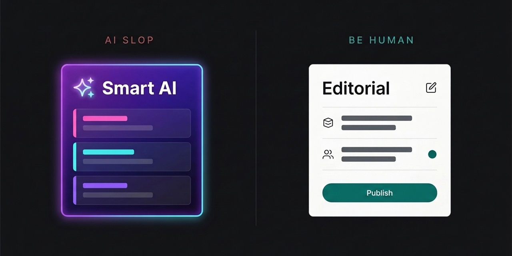

# Be Human

**Be Human** removes the "AI face" from sites, apps, platforms, copy, slides, and anything produced with AI.

## Works Across Every AI Agent

| Agent / Platform | How to Use |
|---|---|
| **Antigravity** | Uses `plugin.json`, `rules/AGENTS.md`, and `skills/` (`~/.gemini/config/plugins/be-human`). |
| **Claude Code** | Add as a plugin marketplace via `.claude-plugin/marketplace.json`, open this folder (`CLAUDE.md`), or run `./install.ps1` / `./install.sh` to copy skills to `~/.claude/skills/`. |
| **OpenAI Codex (CLI & App)** | Reads `AGENTS.md` + `.codex-plugin/plugin.json` + `.agents/plugins/marketplace.json`, or run `./install.ps1` / `./install.sh` to copy skills to `~/.codex/skills/` and `~/.agents/skills/`. |
| **ChatGPT (Custom GPTs / Projects)** | Paste [`chatgpt-and-claude/SYSTEM_PROMPT.md`](chatgpt-and-claude/SYSTEM_PROMPT.md) into Project Instructions or Custom GPT Instructions. |
| **Claude.ai (Projects)** | Paste [`chatgpt-and-claude/SYSTEM_PROMPT.md`](chatgpt-and-claude/SYSTEM_PROMPT.md) into Project Instructions (optionally upload `skills/humanize-copy/references/patterns-*.md`). |
| **Cursor** | Copy `.cursor/rules/be-human.mdc` into your project's `.cursor/rules/`. |
| **GitHub Copilot** | Copy `.github/copilot-instructions.md` into your repo's `.github/`. |
| **Any `agentskills.io` Agent** (OpenCode, Gemini CLI, Amp, Jules) | Run `./install.ps1` (Windows) or `./install.sh` (macOS/Linux) to install to `~/.agents/skills/` (or pass `-ProjectOnly` / `--project` for `./.agents/skills/`). |

## What's Inside (8 Skills + Scripts + Rules)

- **Always-On Rules** (`AGENTS.md`, `CLAUDE.md`, `rules/AGENTS.md`, `.cursor/rules/be-human.mdc`, `.github/copilot-instructions.md`)
- **`be-human-ui`**: Replaces Lucide-react, blue-purple gradient soup, and post-purple fallbacks with Phosphor Icons, Lottie micro-interactions, WCAG-checked hex palettes (`scripts/generate-palette.mjs`), and a production polish checklist.
- **`visual-anchor-to-code`**: "Stop describing, start showing" — generate or inspect visual anchors first, extract layout density, negative space, and tokens, then implement faithfully.
- **`design-md-systems`**: 84 real-world `DESIGN.md` design systems (Linear, Stripe, Raycast, Apple, Notion, Figma, Vercel, etc.) in `skills/design-md-systems/catalog/`.
- **`platform-craft`**: Anti-dashboard app/platform patterns (split-pane triage, `⌘K` command palettes, inline editing, optimistic undo toasts, complete edge states).
- **`de-slop-refactor`**: Before/after rescue workflow for existing AI-generated sites and apps.
- **`human-slides`**: Anti-slop presentations and pitch decks (one insight + one chart per slide, no 6-tile KPI walls).
- **`humanize-copy`**: Removes AI-writing tells from English and Brazilian Portuguese (pt-BR) prose, docs, posts, slides, and UI microcopy.
- **`ui-verify-and-audit`**: Static slop scanner (`scripts/scan-slop.mjs`), Web Interface Guidelines audit, and Playwright browser verification (`scripts/verify-ui.mjs`) at `1440x900` and `390x844`.

## Requirements

- **Node.js 18+** for `generate-palette.mjs` and `scan-slop.mjs` (zero npm dependencies).
- **Playwright** in your target project (`npm i -D playwright && npx playwright install chromium`) to run `skills/ui-verify-and-audit/scripts/verify-ui.mjs`.

## Credits & Upstream Sources

**Be Human** synthesizes and builds upon open-source work from:
- [Leonxlnx/taste-skill](https://github.com/Leonxlnx/taste-skill) & `image-to-code`
- [pbakaus/impeccable](https://github.com/pbakaus/impeccable)
- [VoltAgent/awesome-design-md](https://github.com/VoltAgent/awesome-design-md)
- [vercel-labs/web-interface-guidelines](https://github.com/vercel-labs/web-interface-guidelines)
- [microsoft/playwright](https://github.com/microsoft/playwright)
- [blader/humanizer](https://github.com/blader/humanizer) & Wikipedia's *Signs of AI writing* (WikiProject AI Cleanup)
